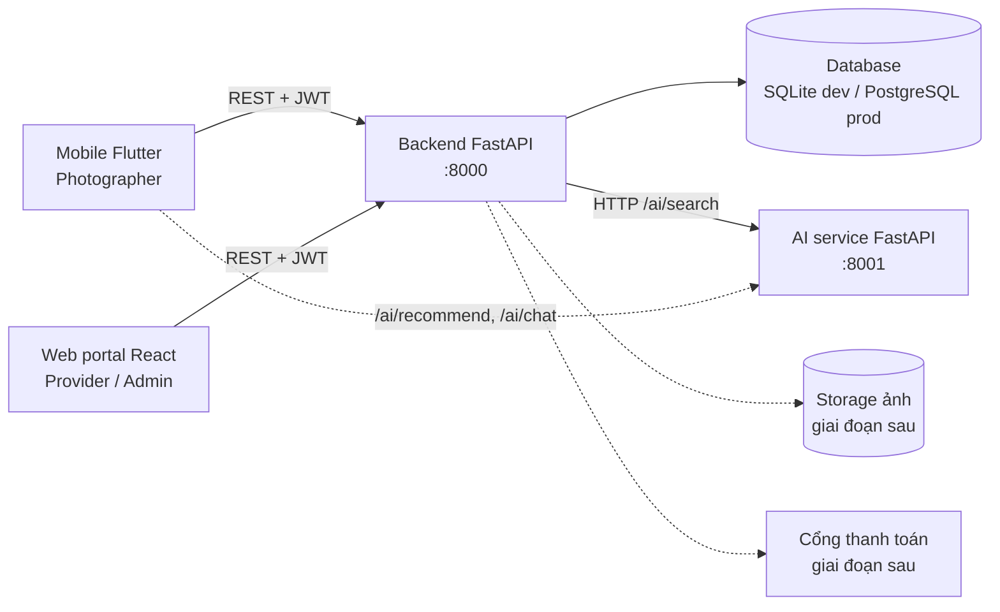

# Kiến trúc hệ thống (Thành viên 1, phối hợp Thành viên 4, 5)

Nét liền: đã có trong MVP. Nét đứt: dự kiến giai đoạn sau.

## Module chính
| Module | Công nghệ | Chủ trì | Ghi chú |
|---|---|---|---|
| Backend API | FastAPI, SQLAlchemy 2, PyJWT | TV1 | Auth, RBAC, spaces, equipment, bookings |
| Database | SQLite (dev), PostgreSQL (prod) | TV1 | Đổi bằng biến `DATABASE_URL` |
| Mobile | Flutter | TV2 | Gọi backend qua REST |
| Web portal | React + TypeScript (Vite) | TV3 | Gọi backend qua REST |
| AI service | FastAPI, scikit-learn | TV4 | Backend gọi `/ai/search`; lỗi thì tự rơi về tìm từ khóa |
| CI/CD, Docker | GitHub Actions, Docker Compose | TV5 | Xem `devops/` |

## Quyết định thiết kế
- **JWT HS256** gắn `sub` (id) và `role`; hết hạn mặc định 120 phút.
- **RBAC** bằng dependency `require_roles(...)` trên từng endpoint.
- **AI tách thành service riêng**, backend coi AI là tùy chọn: AI tắt hoặc lỗi thì search vẫn chạy.
- **Tạo bảng khi khởi động** ở MVP; chuyển sang Alembic migration khi schema ổn định.
