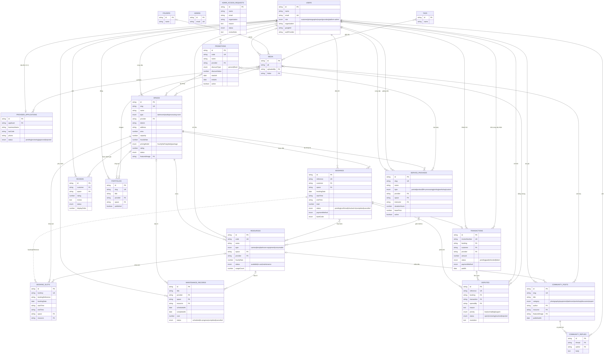

# 🗺️ Mô hình ERD – FILM SPACE

Sơ đồ quan hệ thực thể được lập từ 20 collection trong [`src/collections/`](../src/collections).
Hình ảnh: [`erd.png`](./erd.png) · [`erd.svg`](./erd.svg) · nguồn Mermaid: [`erd.mmd`](./erd.mmd)

## Chú thích

- `PK` khóa chính · `FK` khóa ngoại · `UK` giá trị duy nhất
- `||` đúng 1 · `|o` 0 hoặc 1 · `o{` 0..nhiều · `|{` 1..nhiều
- Đường nét đứt `..` là liên kết logic (không phải khóa ngoại thật): `BOOKING_SLOTS.bookingReference` ↔ `BOOKINGS.reference`
- Thuộc tính chỉ liệt kê các trường chính; xem đầy đủ trong `src/payload-types.ts`

## Các quan hệ chính

| Quan hệ | Bản số | Ghi chú |
| --- | --- | --- |
| USERS → SPACES | 1 – N | Nhà cung cấp sở hữu nhiều không gian |
| SPACES → RESOURCES | 1 – N | Mỗi thiết bị thuộc một không gian |
| USERS → BOOKINGS | 1 – N | Khách hàng đặt chỗ |
| SPACES → BOOKINGS | 1 – N | Một không gian có nhiều lượt đặt |
| BOOKINGS ↔ RESOURCES | N – N | Thuê thiết bị kèm theo |
| BOOKINGS → TRANSACTIONS | 1 – 0..1 | Mỗi lượt đặt có tối đa một giao dịch |
| BOOKINGS → DISPUTES | 1 – N | Tranh chấp phát sinh từ lượt đặt |
| USERS → PROVIDER_APPLICATIONS | 1 – 0..1 | Mỗi người nộp tối đa một đơn |
| SERVICE_PACKAGES ↔ RESOURCES | N – N | Gói dịch vụ gồm thiết bị |
| PROMOTIONS ↔ SPACES / SERVICE_PACKAGES | N – N | Khuyến mãi áp dụng cho nhiều đối tượng |
| COMMUNITY_POSTS → COMMUNITY_REPLIES | 1 – N | Bài viết có nhiều phản hồi |
| MEDIA ↔ SPACES / PORTFOLIOS / DISPUTES… | N – N | Ảnh dùng chung nhiều nơi |

`ADMINS` và `ADMIN_ACCESS_REQUESTS` là các bảng độc lập (tài khoản quản trị Payload và yêu cầu cấp quyền admin).

## Sơ đồ (Mermaid – GitHub tự hiển thị)

```mermaid
erDiagram
    USERS {
        string id PK
        string name
        string email UK
        enum role "customer|photographer|expert|provider|platform-admin"
        string organization
        string googleId
        string authProvider
    }
    ADMINS {
        string id PK
        string email UK
    }
    ADMIN_ACCESS_REQUESTS {
        string id PK
        string name
        string email
        string organization
        text reason
        enum status
        text reviewNote
    }
    PROVIDER_APPLICATIONS {
        string id PK
        string applicant FK
        string businessName
        string taxCode
        string phone
        enum status "pending|reviewing|approved|rejected"
    }
    SPACES {
        string id PK
        string slug UK
        string name
        enum type "darkroom|studio|processing-room"
        string provider FK
        string district
        string address
        number area
        number capacity
        number hourlyRate
        enum pricingModel "hourly|half-day|daily|package"
        number rating
        enum status
        string featuredImage FK
    }
    RESOURCES {
        string id PK
        string code UK
        string name
        enum type "camera|lens|darkroom-equipment|consumable"
        string space FK
        string provider FK
        number hourlyRate
        enum status "available|in-use|maintenance"
        number usageCount
    }
    BOOKINGS {
        string id PK
        string reference UK
        string customer FK
        string space FK
        date bookingDate
        string startTime
        string endTime
        number total
        enum status "pending|confirmed|checked-in|completed|cancelled"
        enum paymentMethod
        enum bankCode
    }
    BOOKING_SLOTS {
        string id PK
        string lockKey UK
        string bookingReference
        date bookingDate
        string startTime
        string endTime
        string space FK
        string resource FK
    }
    TRANSACTIONS {
        string id PK
        string invoiceNumber UK
        string booking FK
        string customer FK
        string provider FK
        number amount
        enum status "pending|paid|refunded|failed"
        enum paymentMethod
        date paidAt
    }
    SERVICE_PACKAGES {
        string id PK
        string slug UK
        string name
        enum type "portrait|product|film-processing|printing|workshop|custom"
        string provider FK
        string space FK
        string instructor FK
        number durationHours
        number basePrice
        boolean active
    }
    PROMOTIONS {
        string id PK
        string code UK
        string name
        string provider FK
        enum discountType "percent|fixed"
        number discountValue
        date startsAt
        date endsAt
        boolean active
    }
    MAINTENANCE_RECORDS {
        string id PK
        string title
        string provider FK
        string space FK
        string resource FK
        date scheduledAt
        date completedAt
        number cost
        enum status "scheduled|in-progress|completed|cancelled"
    }
    DISPUTES {
        string id PK
        string reference UK
        string booking FK
        string transaction FK
        string openedBy FK
        text reason
        enum priority "low|normal|high|urgent"
        enum status "open|reviewing|resolved|rejected"
        text resolution
    }
    REVIEWS {
        string id PK
        string customer FK
        string space FK
        number rating
        text review
        enum status
        number displayOrder
    }
    PORTFOLIOS {
        string id PK
        string slug UK
        string title
        string provider FK
        string space FK
        boolean published
    }
    COMMUNITY_POSTS {
        string id PK
        string slug UK
        string title
        enum category "photography|equipment|darkroom|workshop|discussion|expert"
        string author FK
        string resource FK
        string featuredImage FK
        date publishedAt
    }
    COMMUNITY_REPLIES {
        string id PK
        string thread FK
        string author FK
        text body
    }
    MEDIA {
        string id PK
        string alt
        string uploadedBy FK
        string folder FK
    }
    FOLDERS {
        string id PK
        string name
    }
    TAGS {
        string id PK
        string name
    }

    USERS ||--o| PROVIDER_APPLICATIONS : "nộp đơn (1-1)"
    USERS ||--o{ SPACES : "cung cấp"
    SPACES ||--o{ RESOURCES : "chứa"
    USERS |o--o{ RESOURCES : "sở hữu"
    USERS ||--o{ BOOKINGS : "đặt chỗ"
    SPACES ||--o{ BOOKINGS : "được đặt"
    BOOKINGS }o--o{ RESOURCES : "thuê kèm"
    BOOKINGS ||..o{ BOOKING_SLOTS : "bookingReference"
    SPACES ||--o{ BOOKING_SLOTS : "khóa lịch"
    RESOURCES |o--o{ BOOKING_SLOTS : "khóa lịch"
    BOOKINGS ||--o| TRANSACTIONS : "thanh toán"
    USERS ||--o{ TRANSACTIONS : "khách trả"
    USERS |o--o{ TRANSACTIONS : "nhà cung cấp nhận"
    BOOKINGS ||--o{ DISPUTES : "phát sinh"
    TRANSACTIONS |o--o{ DISPUTES : "liên quan"
    USERS ||--o{ DISPUTES : "mở bởi"
    USERS ||--o{ SERVICE_PACKAGES : "cung cấp"
    USERS |o--o{ SERVICE_PACKAGES : "giảng viên"
    SPACES ||--o{ SERVICE_PACKAGES : "áp dụng tại"
    SERVICE_PACKAGES }o--o{ RESOURCES : "gồm thiết bị"
    USERS ||--o{ PROMOTIONS : "tạo"
    PROMOTIONS }o--o{ SPACES : "áp dụng"
    PROMOTIONS }o--o{ SERVICE_PACKAGES : "áp dụng"
    USERS ||--o{ MAINTENANCE_RECORDS : "phụ trách"
    SPACES |o--o{ MAINTENANCE_RECORDS : "bảo trì"
    RESOURCES |o--o{ MAINTENANCE_RECORDS : "bảo trì"
    USERS |o--o{ REVIEWS : "viết"
    SPACES ||--o{ REVIEWS : "được đánh giá"
    USERS ||--o{ PORTFOLIOS : "đăng"
    SPACES |o--o{ PORTFOLIOS : "chụp tại"
    USERS |o--o{ COMMUNITY_POSTS : "tác giả"
    RESOURCES |o--o{ COMMUNITY_POSTS : "nhắc đến"
    COMMUNITY_POSTS ||--o{ COMMUNITY_REPLIES : "có phản hồi"
    USERS ||--o{ COMMUNITY_REPLIES : "viết"
    USERS |o--o{ MEDIA : "tải lên"
    FOLDERS |o--o{ MEDIA : "chứa"
    TAGS }o--o{ MEDIA : "gắn thẻ"
    MEDIA |o--o{ SPACES : "ảnh đại diện / gallery"
    MEDIA |o--o{ COMMUNITY_POSTS : "ảnh bìa"
    MEDIA }o--o{ PORTFOLIOS : "images"
    MEDIA }o--o{ PROVIDER_APPLICATIONS : "portfolio"
    MEDIA }o--o{ DISPUTES : "bằng chứng"
```

